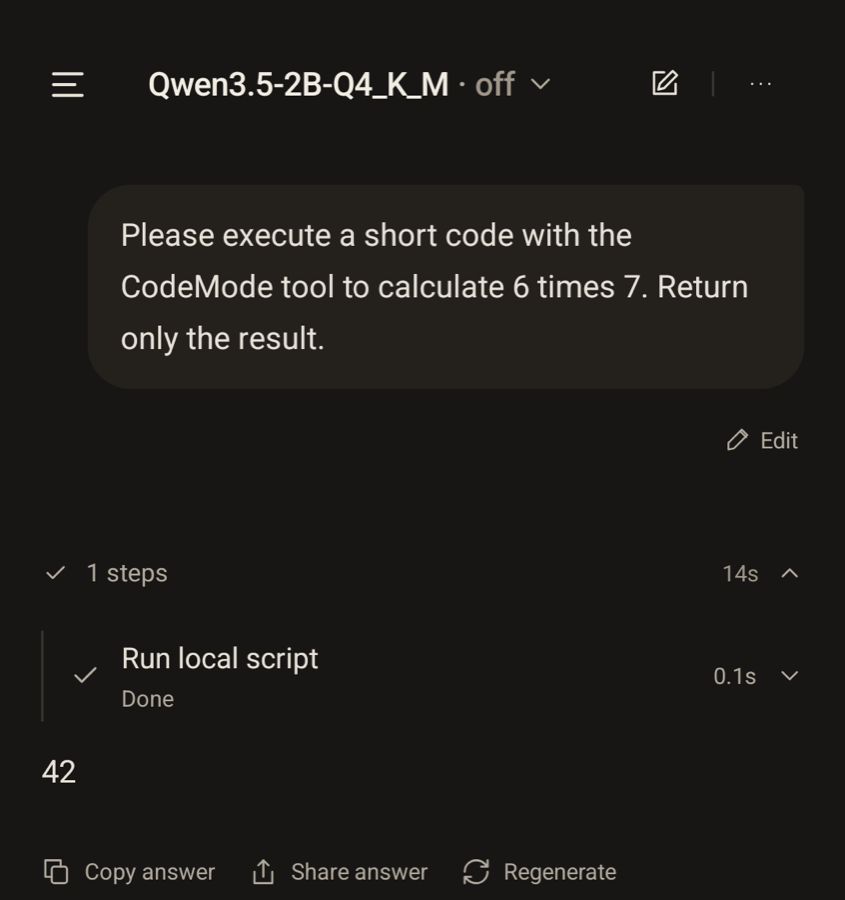
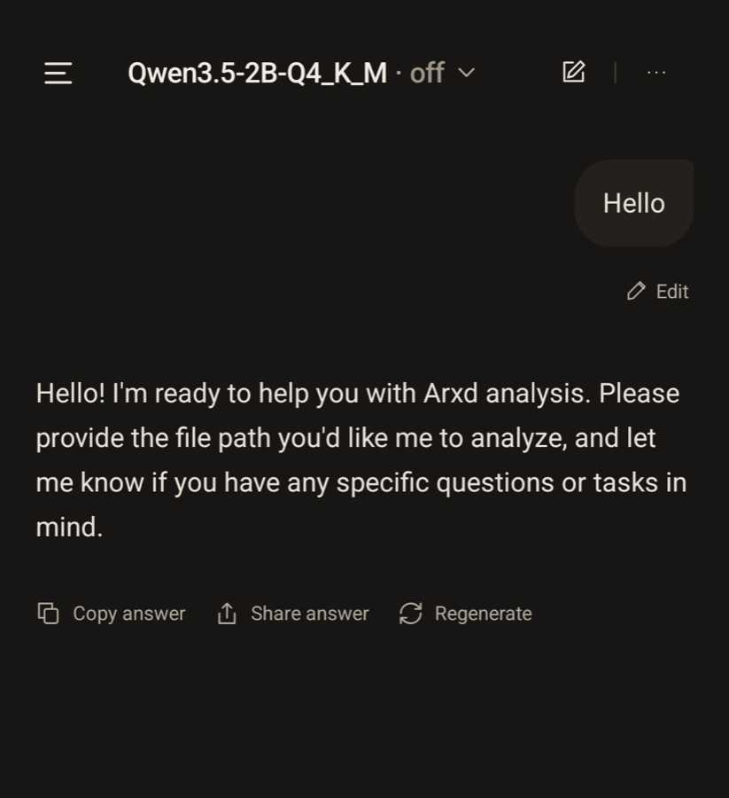
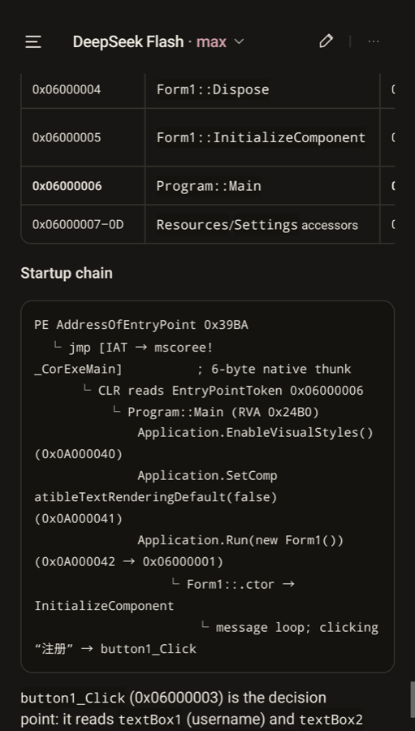

<a href="README.zh-CN.md">简体中文</a>

  

<h1 align="center">Arxd</h1>

Arxd is an open-source, on-device Android agent built for **RxD (Rust x Decompiler, not yet open source)**.

Built on **Pi-Durable, Termux, and RxD**, Arxd supports:

1. **MCP** — connect external tools and services.
2. **Skills** — extend the agent with reusable capabilities and workflows.
3. **CodeMode** — orchestrate tool calls with code.
4. **Shell Execute** — use capabilities provided by the Termux environment, including Node.js, Python, and Git.
5. **Custom model configuration** — use API keys, account-based authentication, and compatible on-device GGUF models.
6. **Reverse engineering (coming soon)** — RxD provides the core analysis capabilities, with support for more reverse-engineering workflows to come.

## Installation

[Download APK](https://github.com/TsingShui/Arxd/releases/download/release-beta-0.1.0/arxd-lite-0.1.0-arm64-v8a.apk) · [Release notes & checksums](https://github.com/TsingShui/Arxd/releases/tag/release-beta-0.1.0)

Full source builds: run **Build Full signed APK** in GitHub Actions on `main`.
Successful runs provide an `arxd-full-*` artifact containing the signed ARM64 APK,
checksums and build identity for 14 days; they do not publish a GitHub Release.

Download and open the APK on your Android ARM64 device to install.

## Releases and Documentation

- [Releases](https://github.com/TsingShui/Arxd/releases)
- [Build and Release](docs/release.md)
- [JSON Model Configuration](docs/model-config.md)
- [Background Agent and Termux ADB Shell](docs/adb-shell.md)
- [eCapture + tshark Network Research](docs/network-capture.md)
- [ADB Authorization (Native Virtual Display client)](docs/adb-authorization.md)
- [Split-screen Analysis](docs/split-screen.md)
- [Virtual Display App Launch (Experimental)](docs/virtual-display.md)
- [Architecture](docs/design/arxd-design.md)
- [Security](SECURITY.md)

## MCP Support

Connect command-based or HTTP MCP servers, manage their configuration, and browse or search their available tools. Connected tools are available to the Agent in conversations.

## CodeMode

  

A real CodeMode run executes JavaScript and returns `42`.

## Local Model Qwen

  

On-device GGUF · Qwen3.5-2B-Q4_K_M · “Hello”

## Reverse

  

Reverse-analysis view from the latest device screenshot.

## License

Arxd is licensed under [Apache-2.0](LICENSE). See [NOTICE](NOTICE) for third-party attributions.
